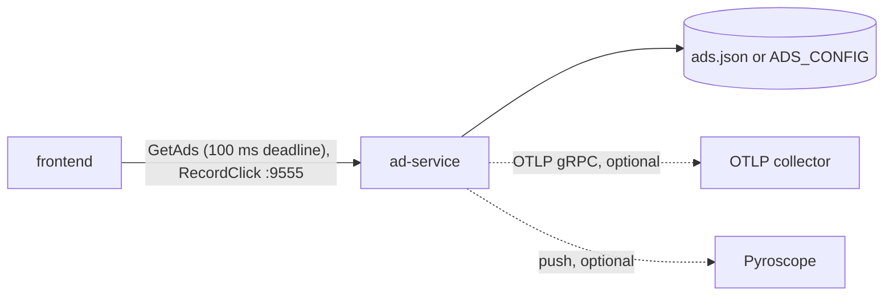

# Architecture

## Context



ad-service calls no other service. The ads come from a JSON config (the bundled `ads.json`, or the file named by `ADS_CONFIG`), read once at start. The impression and click counters live in memory, per process. The calls `GetAds` and `RecordClick` from the frontend were checked in its `origin/main` code on 2026-11-21 (`cmd/server/rpc.go`, `cmd/server/ads.go`); `GetAdStats` has no caller in the frontend.

## Request path

```mermaid
sequenceDiagram
    participant FE as frontend
    participant AD as ad-service
    FE->>AD: GetAds(context_keys)
    Note over AD: match keys against the configured ads, rotate, up to 2; none matched: 2 different random ads
    AD-->>FE: ads (each counts one impression)
    FE->>AD: RecordClick(ad id)
    AD-->>FE: counted, or NOT_FOUND for an unknown id
```

The matching rules and the config schema are in the README. The counters are exported as `ads_impressions_total{ad_id}` and `ads_clicks_total{ad_id}` over OTLP next to the `rpc_server_*` metrics.

## Components

| File | Role |
|---|---|
| `src/main/java/hipstershop/AdService.java` | entry point: loads the ad config (exit 1 if invalid), telemetry bootstrap, gRPC server with health and reflection, shutdown hook |
| `AdServiceImpl.java`, `AdCatalog.java`, `AdsMap.java`, `AdConfigException.java` | the handlers, loading and validating the config, matching and rotation, the bundled default catalog |
| `AdStats.java` | thread-safe in-memory impression and click counters |
| `Metrics.java`, `Telemetry.java`, `OtlpEnv.java`, `LogConfig.java`, `BuildInfo.java` | OTel metrics (`rpc_server_*`, `ads_*_total`, `build_info`), the SDK and Pyroscope setup with bounded shutdown, OTLP environment, log level and version |
| `HealthCheck.java` | the `healthcheck` entry point of the image `HEALTHCHECK` (exits 0 only on `SERVING`) |
| `src/main/proto/ad.proto` | the service contract (package `hipstershop`, additive changes only) |

## Decisions

[ADR 1](adr/0001-ads-from-config-with-in-memory-counters.md).
